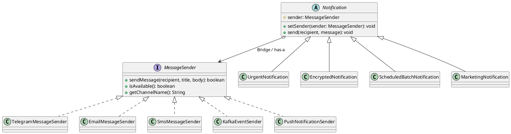

# Assignment 3 — Multi-Channel Notification Gateway

## Pattern
Bridge Pattern

## Two independent dimensions
1. **Abstraction:** notification types (`UrgentNotification`, `EncryptedNotification`, `ScheduledBatchNotification`, `MarketingNotification`).
2. **Implementation:** delivery providers (`TelegramMessageSender`, `EmailMessageSender`, `SmsMessageSender`, `KafkaEventSender`, `PushNotificationSender`).

## Where is the Bridge?
The field `protected MessageSender sender` inside `Notification` is the bridge. Notification classes do not depend on concrete sender classes. They work through the `MessageSender` interface.

## Why is inheritance problematic?
Without Bridge, every notification type would need a separate class for every delivery provider, for example `UrgentTelegramNotification`, `UrgentEmailNotification`, and so on. With N notification types and M providers, this creates N × M combinations.

## What happens when a new provider is added?
A new class only needs to implement `MessageSender`. Existing `Notification` classes do not need modification. `PushNotificationSender` demonstrates this.

## What happens when a new Notification type is added?
A new class extends `Notification` and can use every existing `MessageSender`. `MarketingNotification` demonstrates this.

## Why Bridge rather than Adapter?
Bridge is used here to intentionally separate two dimensions that must evolve independently. Adapter is normally used to make an incompatible existing interface work with another interface.

## Features
- Telegram, Email, SMS, Kafka, Push providers
- Urgent notification with fallback
- Base64 encrypted notification
- Batch sending with summary
- Runtime provider switching
- 12 JUnit 5 tests

## Run
```bash
mvn test
mvn exec:java -Dexec.mainClass=Main
```
Or run `Main.java` directly from IntelliJ IDEA.

## Mandatory demo scenarios
1. UrgentNotification + Telegram
2. EncryptedNotification + Email
3. ScheduledBatchNotification + SMS
4. Runtime switching: Telegram -> Email
5. Telegram unavailable -> fallback SMS
6. MarketingNotification + PushNotificationSender

## UML (PlantUML)

